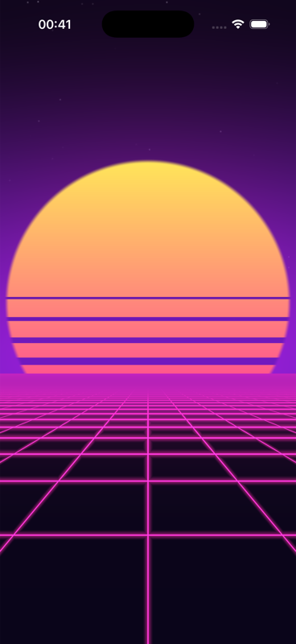
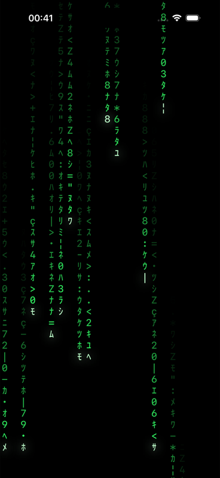
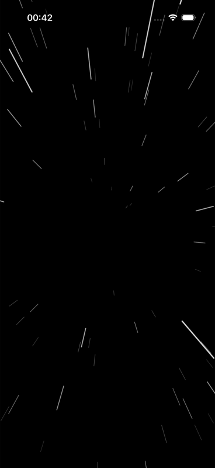
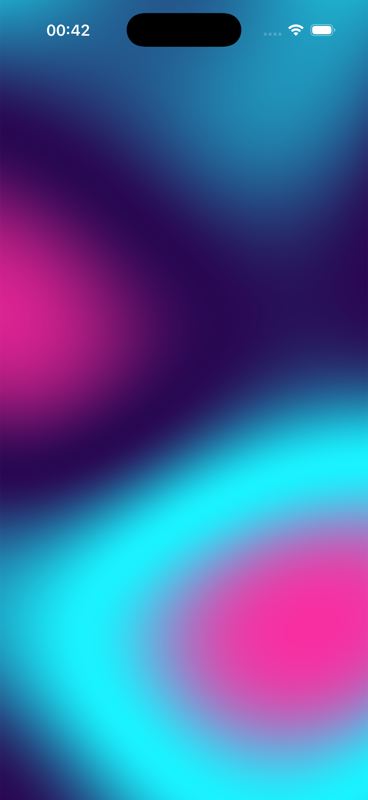
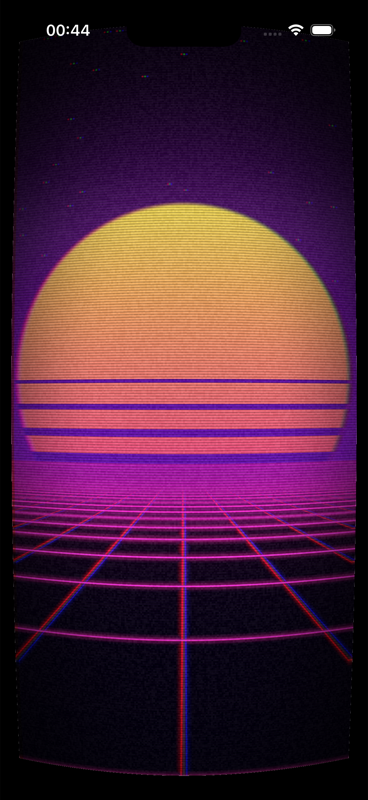

# BRSRetro

Retro-vibe background animations for SwiftUI, each one a nod to a movie, a
game or a demo you grew up with. Drop one behind your content and the screen
turns into 1986.

| Animation | Inspired by | Rendering |
| --- | --- | --- |
| `SynthwaveGridView` | Tron · Drive · Outrun | Metal shader |
| `DigitalRainView` | The Matrix | Canvas |
| `HyperspaceView` | Star Wars · classic starfield screensaver | Canvas |
| `PlasmaView` | Amiga / C64 demoscene | Metal shader |
| `.crtOverlay()` and `CRTOverlayView` | Stranger Things · a worn VHS tape | Metal shader |

<p align="center">
  
  
  
  
  
</p>

## Requirements

- iOS 17, macOS 14, tvOS 17 or visionOS 1
- Xcode 15 or later, with the Metal toolchain installed. Xcode 26 ships without
  it; run `xcodebuild -downloadComponent MetalToolchain` once.
- Swift 6 language mode (the package compiles clean under strict concurrency)

`swift build` and `swift test` work from the command line, but only Xcode and
`xcodebuild` compile the `.metal` files into the package's resource bundle. A
binary produced by plain `swift build` runs the Canvas animations and draws
nothing for the shader ones, and the command line warns about the unhandled
Metal files. That is expected.

## Installation

Add the package in Xcode (File → Add Package Dependencies…) or in `Package.swift`:

```swift
dependencies: [
    .package(url: "https://github.com/brssgn/BRSRetro.git", from: "0.1.0"),
],
targets: [
    .target(
        name: "MyApp",
        dependencies: [
            .product(name: "BRSRetro", package: "BRSRetro"),
        ]
    ),
]
```

The module you import is `BRSRetro` as well.

## Usage

The one-liner:

```swift
import BRSRetro

struct ContentView: View {
    var body: some View {
        Text("INSERT COIN")
            .font(.system(.largeTitle, design: .monospaced))
            .foregroundStyle(.white)
            .retroBackground(.synthwaveGrid)   // .digitalRain, .hyperspace, .plasma
    }
}
```

Or use the views directly and tune them:

```swift
SynthwaveGridView(speed: 0.8, gridColor: RetroPalette.neonCyan)

DigitalRainView(fontSize: 14, density: 0.6, color: RetroPalette.sunsetOrange)

HyperspaceView(starCount: 800, streakLength: 1.5, warpIn: 4)

PlasmaView(scale: 5, colors: (RetroPalette.midnight, RetroPalette.neonCyan, RetroPalette.matrixGreen))
```

Run anything through an old television:

```swift
MyScreen()
    .crtOverlay()               // curvature, RGB split, scanlines, grain, rolling bar
    .crtOverlay(.subtle)        // scanlines and vignette only, safe for text
    .crtOverlay(CRTSettings(curvature: 0.3, chroma: 2, rollingBar: 0))
```

`.crtOverlay()` samples the view beneath it, so it costs a full-screen pass.
With curvature on, the corners outside the curved picture are painted black,
like a bezel.
`CRTOverlayView` is the cheap alternative: a transparent layer of scanlines and
vignette you stack on top of any background in a `ZStack`.

All views fill the space they are given, ignore touches, and pause when the
system Reduce Motion setting is on (a still frame stays in place).

`RetroPalette` holds the neon colors the defaults use, so custom tweaks stay
on-theme.

## Adding an animation

Contributions of new animations are the point of this repository. To add one:

1. Create `Sources/BRSRetro/Animations/YourThingView.swift` with a
   `public struct YourThingView: View`. Give every tunable a public property
   with a default that looks good untouched, and add `#Preview`s.
2. Drive time with `RetroTimeline { elapsed in ... }` so Reduce Motion is
   honored for free. Use `Canvas` for scenes made of objects, or a Metal
   shader in `Sources/BRSRetro/Shaders/` (reach it through
   `RetroShaders.library.yourFunction(...)`) for per-pixel effects.
3. Keep any simulation in a plain class with `configure(...)` and `step(to:)`
   methods, seeded with `RetroRandom`, so it can be covered by a test under
   `Tests/BRSRetroTests/`. See `DigitalRainSimulation` for the pattern.
4. Add a case to `RetroBackground` if the animation works as a full-screen
   background with no setup, and a row to the table above with what it is
   inspired by.
5. Run `swift test`, then build once in Xcode to be sure the shader compiles.

Please keep to the spirit of "inspired by": original drawings in the style of
a reference, not its logos, characters or assets.

## License

MIT. See [LICENSE](LICENSE).
